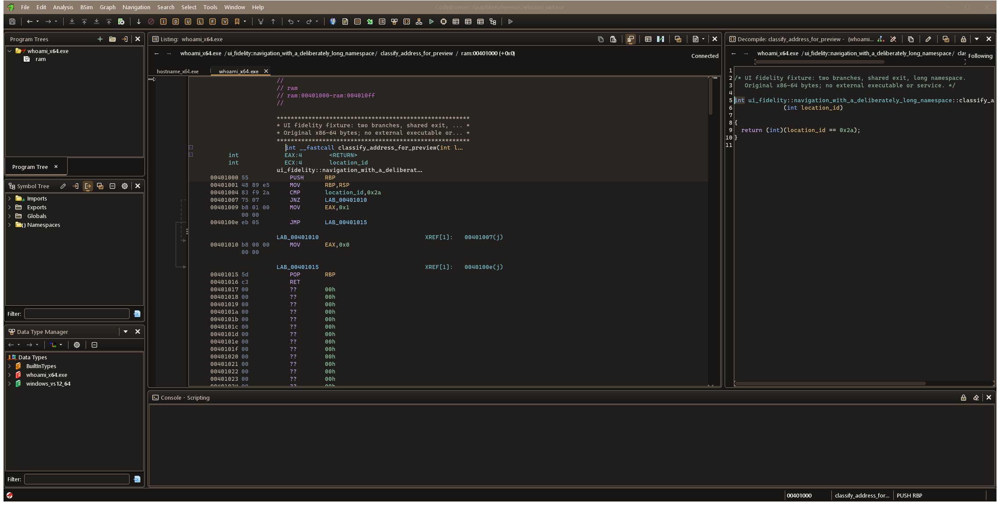

# Graphite reference pack — v0.1

Captured on Windows on 2026-11-11 from Ghidra 12.3 DEV with the changed Gui/Base/Decompiler jars.
[Capture manifest](capture-manifest.json) records the jar hashes; [probe provenance](probe-provenance.json)
records the source adaptation. These are in-process Swing renders at Java scale 1.0, not physical
DPI, native-window or accessibility acceptance. [Capture log](capture.csv) records theme switching
and saved-copy checks. No specialist provider is accepted by these screenshots.

| Reference | Inspect | Current limitations |
| --- | --- | --- |
| [Token/state sheet](tokens.svg) | Warm graphite roles, amber navigation, copper depth, distinct cyan focus and semantic feedback; all nine control states | The sheet is a design specification. Stronger gradient stops and every state treatment are not yet adopted by all live widgets. |
| [Code Browser](code-browser.png) | Real instructions/C, two programs, long namespace/function, explicit address space and provider-local context | Breadcrumb overflow scrolls; namespace navigation and responsive height/overflow design are still open. |
| [Front End](front-end.png) | Tool Chest, project tree, filter, workspace and running tools | Branded/raster artwork, native title-bar legibility and individual entry dialogs need later review. |
| [Navigation options](options.png) | Actual settings form, grouping, selectors, checkbox rows, buttons and focus | Inherited form layout; not the completed individual-dialog redesign. |
| [Dense Symbol Table](dense-symbols.png) | 51 real fixture symbols, long labels, namespaces, alternating rows, headers, filters and keyboard focus outline | Intentional long-name truncation exposes the need for column sizing/overflow review. Full selection, sorting, filtering and custom-renderer acceptance remain open. |
| [Function Graph](function-graph.png) | Four real blocks, conditional/fallthrough edges, selected entry, shared exit and minimap | Existing Refresh cards/edges are a foundation; graph redesign and large-graph performance are later milestones. |
| [Bytes](bytes.png) | Actual raw code/string bytes, addresses and header/body contrast | Editing, changed/stale states, scaling and dense data interaction remain unreviewed. |
| [Action chooser](action-chooser.png) | Real actions and shortcut text | Current chooser behavior is not the integrated IDE search milestone. |

The fixture contains original x86-64 bytes, two functions, 48 additional named labels, a string,
and deliberately long namespace content. The familiar executable suffixes are probe compatibility
names for raw synthetic inputs. See [fixture preparation](../FIXTURES.md).

## Compatibility and evidence

- [IDE diagnostics cleanup](ide-diagnostics.json): zero errors/warnings in the inspected files;
  IDE build and 24 regression tests pass. Glyph assets are byte-for-byte unchanged. The PNGs and
  capture manifest above remain the original visual baseline from before this cleanup.

- [Stock theme after switching](stock-code-browser.png) and [saved Graphite copy](copied-theme-code-browser.png)
  demonstrate live theme restoration/copying in this test process. This does not test a process restart.
- The copied theme retains geometry/chrome properties and packaged graphite icon paths.
  The known bitmap-on-reload limitation remains open; valid icon paths do not certify vector persistence.
- [Seven location-context integration tests](location-context-tests.xml) and
  [syntax/graph contrast across six themes](theme-contrast-tests.xml) have zero failures.
- [Token contrast report](contrast.md) has zero failures across 25 checked foreground/background pairs.
- [Original runtime registrations](runtime-surfaces.csv) retain the initial Code Browser baseline.
  [Expanded runtime evidence](runtime/) now contains Code Browser, Front End, Debugger, Version
  Tracking and two actual dialog snapshots, with installed-module and capture provenance.
  [Reconciliation findings](../RUNTIME-RECONCILIATION.md) distinguish implementation classes,
  registering owners and per-module gaps. Registration is not visual or interaction review.
- [Specialist preparation evidence](specialists/) records comparison/VT/BSim/saved-trace and real
  two-user repository/merge inputs. Populated specialist UI and live Windows debugger acceptance
  remain open; the prepared conflict has deliberately not been resolved.

Source-driven discovery has 10,243 candidates across 132 module/build roots. That count includes
infrastructure, entry hooks and assets; it is not 10,243 distinct UI windows. Full first-party runtime
reconciliation, optional/specialist fixtures, physical Windows DPI, accessibility, performance and
restart testing remain explicit release blockers. Review progress lives in [the coverage ledger](../surfaces.csv).
